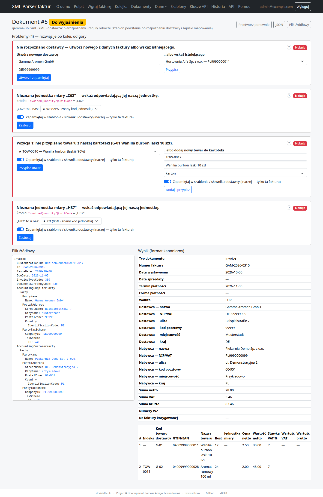
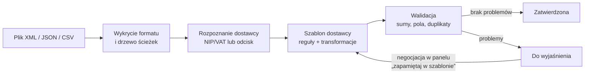
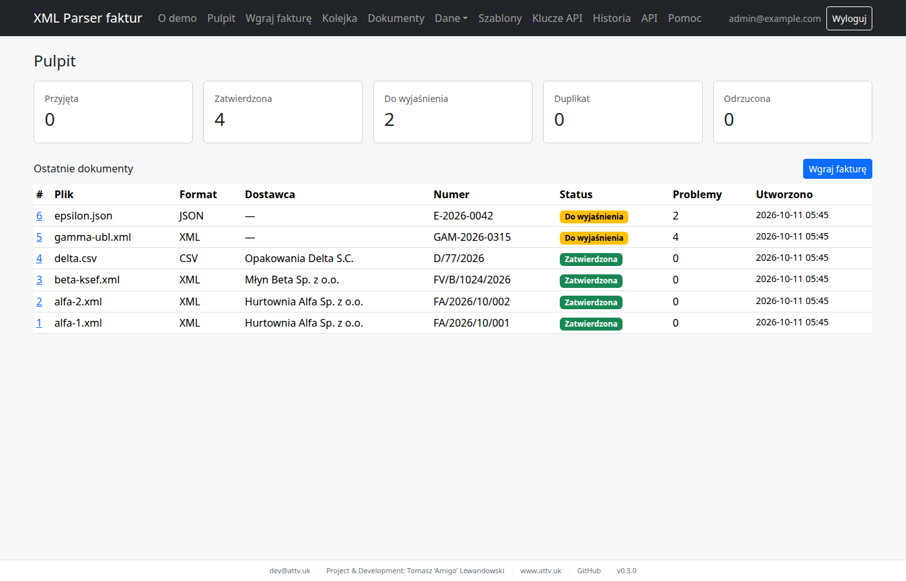
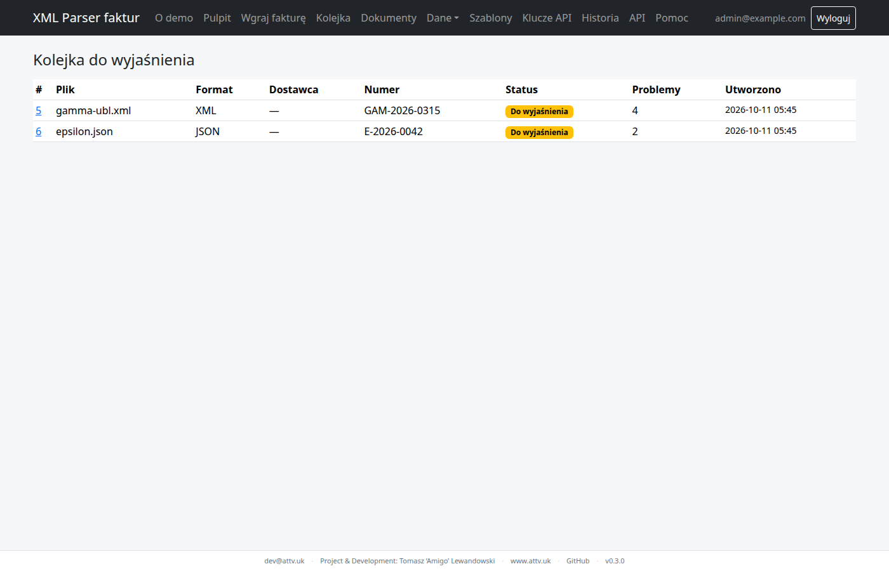
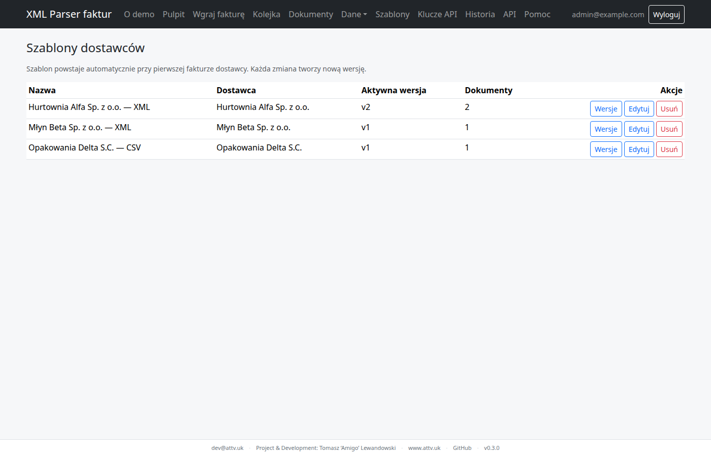
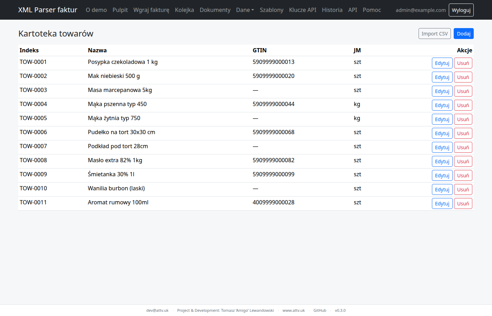
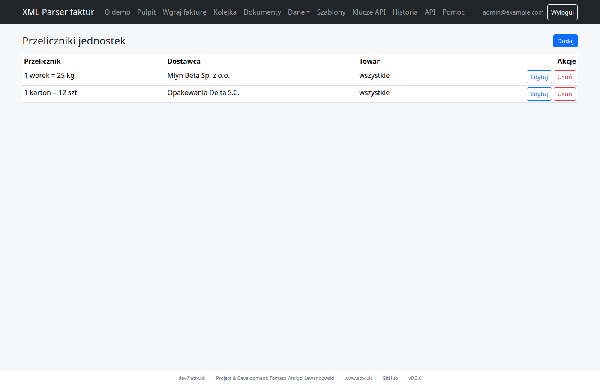
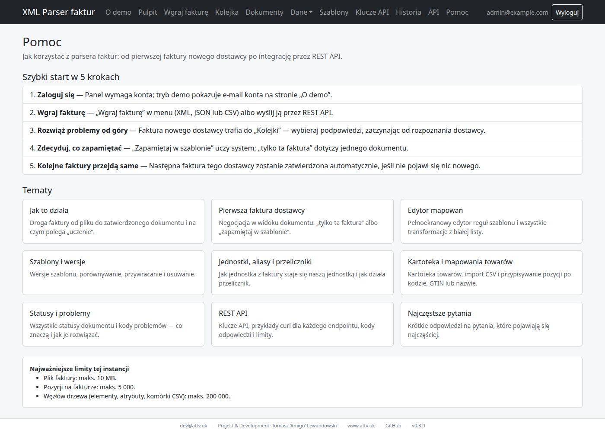
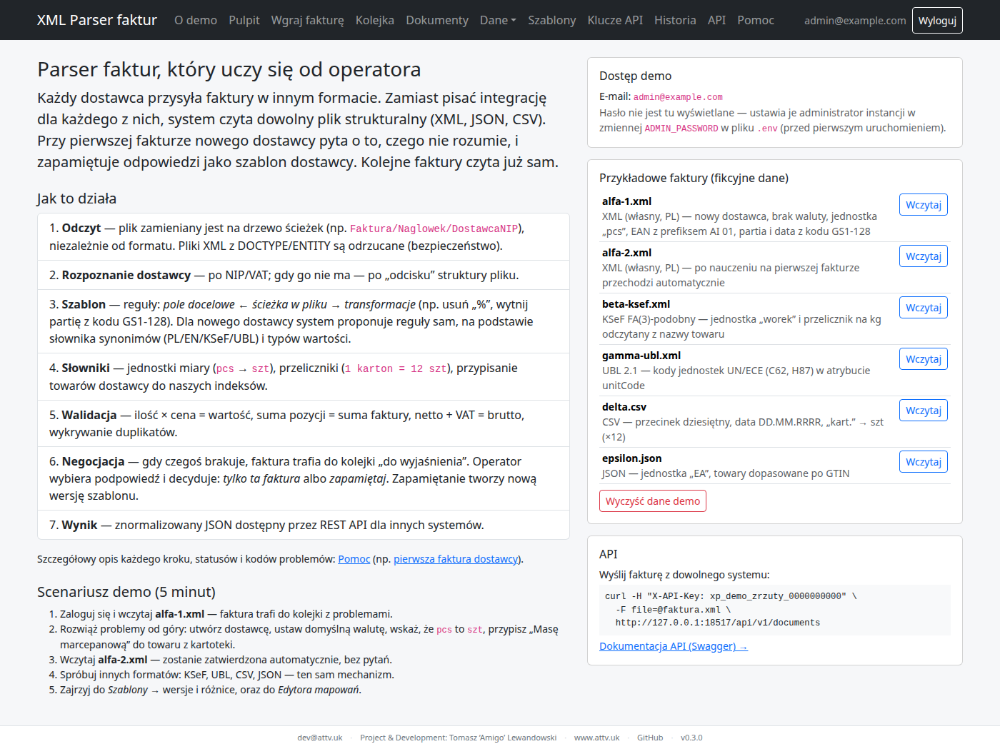
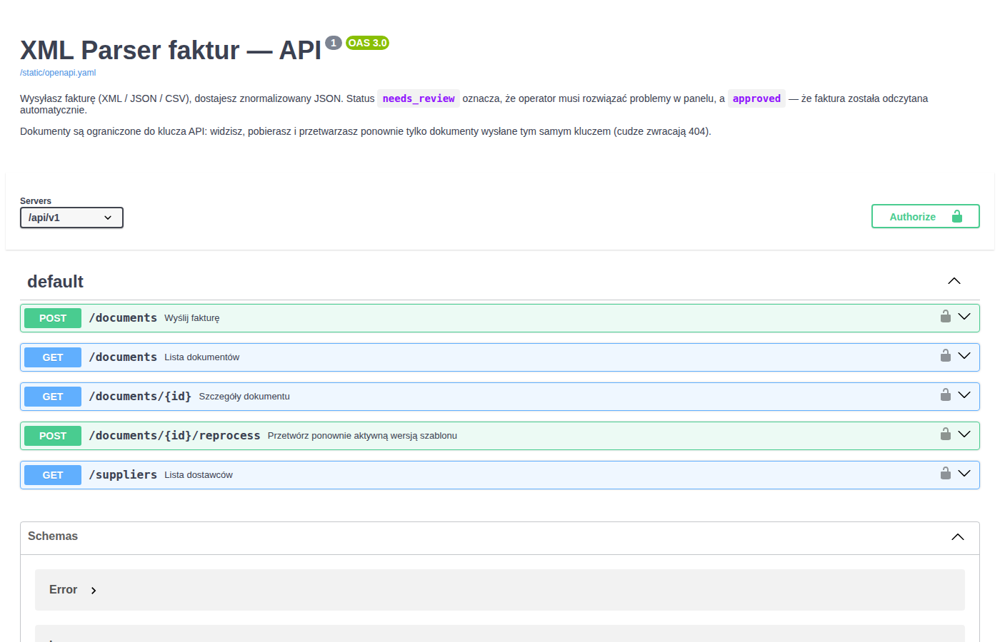

# XML Parser faktur

[](https://github.com/AmigoUK/xml-parser/actions/workflows/ci.yml)
[](https://github.com/AmigoUK/xml-parser/releases)


**Uczący się parser faktur strukturalnych.** Czyta faktury XML (także KSeF FA(2)/FA(3) i UBL 2.1), JSON
i CSV od dowolnych dostawców i zamienia je na jeden dokument kanoniczny. Przy **pierwszej** fakturze
nowego dostawcy operator w panelu „negocjuje” odczyt: wskazuje pola, jednostki, przeliczniki i towary.
Decyzje zapisują się w szablonie dostawcy, więc **kolejne faktury przechodzą automatycznie**.
Bez LLM: deterministyczne reguły i transformacje z białej listy.

- **REST API v1** (`X-API-Key`) dla innych systemów + **panel po polsku** z trybem demo.
- 📖 **Pomoc:** w panelu pod `/pomoc` oraz w repo: [docs/pomoc](docs/pomoc/README.md).
- 📝 Zmiany: [CHANGELOG.md](CHANGELOG.md) · Specyfikacja: [design](docs/superpowers/specs/2026-10-10-xml-invoice-parser-design.md)



## Funkcje

| Obszar | Co potrafi |
|---|---|
| Wejście | Upload w panelu (drag & drop) lub `POST /api/v1/documents`; XML, JSON, CSV (`;`/`,`, UTF-8 i Windows-1250); wykrywanie formatu po treści |
| Rozpoznanie dostawcy | po NIP/VAT, a gdy go brak — po „odcisku” struktury pliku (podobieństwo ścieżek) |
| Szablony | mapowanie ścieżka → pole, łańcuchy transformacji, wartości domyślne; wersjonowanie, historia i przywracanie wersji |
| Transformacje | m.in. `decimal` (przecinek/kropka, tysiące, nawiasy = ujemna), `date`, `regex_extract` z limitem czasu, `map`, `convert`, `negate`, `gs1`, `strip_ai_prefix`, `concat`, `split` (pełna lista w [pomocy](docs/pomoc/edytor-mapowan.md)) |
| GS1 | parser GS1-128 (AI 01 z walidacją cyfry kontrolnej GTIN, 10 partia, 11/13/15/17 daty) |
| Jednostki | słownik jednostek i aliasów (globalnych i per dostawca), przeliczniki np. `kart.` → 12 szt, `worek` → 25 kg |
| Towary | kartoteka z importem CSV, mapowanie pozycji dostawcy na nasz indeks po kodzie/GTIN |
| Walidacja | sumy pozycji i nagłówka (tolerancja 0,01), pola wymagane, niejednoznaczne liczby (`1,234`), duplikaty w zakresie klucza API |
| Kolejka | dokumenty „Do wyjaśnienia” z podpowiedziami (% pewności) i wyborem „tylko ta faktura” / „zapamiętaj w szablonie” |
| Bezpieczeństwo | ochrona przed XXE i billion laughs, limity rozmiaru/węzłów/pozycji, haszowane klucze API, CSRF, CSP, limit prób logowania |

## Jak to działa



Szczegóły krok po kroku: [docs/pomoc/jak-to-dziala.md](docs/pomoc/jak-to-dziala.md).

## Zrzuty ekranu

Wszystkie dane na zrzutach są fikcyjne (próbki z [`demo/samples`](demo/samples/README.md)).

| | |
|---|---|
| <br/>**Pulpit** — po nauczeniu na alfa-1 faktura alfa-2 zatwierdzona automatycznie | <br/>**Kolejka do wyjaśnienia** |
| <br/>**Edytor mapowań** — klik w element pliku → klik w pole, podgląd na żywo | <br/>**Szablony dostawców** z wersjami |
| <br/>**Kartoteka towarów** | <br/>**Przeliczniki jednostek** |
| <br/>**Pomoc** w panelu | <br/>**Kody problemów** z opisem rozwiązania |
| <br/>**Tryb demo** z próbkami faktur | <br/>**Dokumentacja API** (OpenAPI) |

## API w 30 sekund

```bash
# wyślij fakturę (klucz API tworzysz w panelu: „Klucze API”)
curl -H "X-API-Key: TWÓJ_KLUCZ" -F file=@demo/samples/alfa-1.xml http://localhost:18506/api/v1/documents
# → 201 {"id": 1, "status": "needs_review", "issues": [...]}

curl -H "X-API-Key: TWÓJ_KLUCZ" http://localhost:18506/api/v1/documents/1
curl -H "X-API-Key: TWÓJ_KLUCZ" "http://localhost:18506/api/v1/documents?status=approved"
curl -X POST -H "X-API-Key: TWÓJ_KLUCZ" http://localhost:18506/api/v1/documents/1/reprocess
```

Pełny opis endpointów, kodów odpowiedzi i limitów: [docs/pomoc/api.md](docs/pomoc/api.md),
w panelu: `/api/docs` (OpenAPI: [`app/static/openapi.yaml`](app/static/openapi.yaml)).

## Uruchomienie (Docker)

```bash
cp .env.example .env   # uzupełnij hasła
docker compose up -d --build
# panel (Tailscale MagicDNS): http://<nazwa-hosta>.<tailnet>.ts.net:${APP_PORT}   (domyślnie APP_PORT=18506; kontener nasłuchuje wewnętrznie na 5010)
```

Domyślnie port jest publikowany **tylko na 127.0.0.1** (`APP_BIND`). Docker omija ufw, więc `0.0.0.0`
wystawia aplikację na całą sieć. Aby udostępnić panel przez Tailscale, ustaw w `.env`
`APP_BIND=<IP interfejsu tailscale0>` (`tailscale ip -4`) i zrestartuj stack.

`MARIADB_PASSWORD` i `MARIADB_ROOT_PASSWORD` są wymagane (compose przerwie start bez nich).
Kontener aplikacji działa jako użytkownik nie-root (uid 10001); entrypoint przy starcie naprawia
właściciela wolumenu storage i czeka na bazę (migracje z ponawianiem). `/healthz` sprawdza połączenie
z bazą (503 przy awarii), a compose ma healthcheck usługi `app`. Limity zasobów: `APP_MEM_LIMIT`,
`APP_CPUS`, `DB_MEM_LIMIT`, `DB_CPUS`. Logi dockera są rotowane (10 MB x 3). Zależności runtime
są przypięte w `requirements.lock` (używany w obrazie), obrazy bazowe w konkretnych wersjach.

## Kopie zapasowe i odtwarzanie

```bash
tools/backup.sh          # dump MariaDB + archiwum storage do backups/<data>/ (retencja 14 dni; argument = liczba dni)
# cron (codziennie 03:15):  15 3 * * *  cd /ścieżka/do/xml-parser && tools/backup.sh >> backups/backup.log 2>&1
```

Odtwarzanie (na działającym stacku; **nadpisuje bieżące dane**):

```bash
B=backups/<data>
gunzip -c $B/db.sql.gz | docker compose exec -T db sh -c 'MYSQL_PWD="$MARIADB_ROOT_PASSWORD" mariadb -uroot'
gunzip -c $B/storage.tar.gz | docker compose exec -T app tar -C /data/storage -xf -
docker compose restart app
```

Okresowo sprawdź kopię, odtwarzając ją na osobnym środowisku.

Serwer: gunicorn z workerami wątkowymi (`-k gthread -w 2 --threads 8 --timeout 60`), dzięki czemu
bezczynne połączenia przeglądarki nie blokują aplikacji. Ustawienia można nadpisać zmienną
`GUNICORN_CMD_ARGS` (np. w `.env`: `GUNICORN_CMD_ARGS=-k gthread -w 4 --threads 16 --timeout 90`);
gdy zmienna jest ustawiona, zastępuje całe powyższe domyślne zestawienie flag.

## Rozwój lokalny

```bash
python3 -m venv .venv && . .venv/bin/activate
pip install -r requirements-dev.txt
ln -sf ../../tools/pre-commit .git/hooks/pre-commit
pytest
```

## Dane prywatne

Realne faktury trzymaj **wyłącznie** w `private/` (ignorowane przez git).
Test `tests/test_no_private_data.py` (i hook pre-commit) szuka w śledzonych plikach
zakazanych tokenów (nazwy, NIP-y) wczytywanych z lokalnego pliku
`private/forbidden-tokens.txt` (jeden token na linię, małymi literami, `#` = komentarz).
Plik jest ignorowany przez git; bez niego skan jest pomijany — utwórz go na każdej maszynie deweloperskiej.

## Tryb demo

Domyślnie `DEMO_MODE=0`. `DEMO_MODE=1` włącza publiczną stronę „O demo” (opis, próbki faktur,
e-mail konta demo) oraz kartotekę i klucz API demo. Strona **nigdy nie pokazuje hasła** —
hasło ustawiasz w `ADMIN_PASSWORD` w `.env`. Klucz API demo widzą tylko zalogowani, a reset danych
(„Wyczyść dane demo”) może wykonać tylko administrator. Nie używaj `DEMO_MODE=1` na instancji
z prawdziwymi danymi.

## Bezpieczeństwo panelu

| Zmienna | Domyślnie | Znaczenie |
|---|---|---|
| `SESSION_COOKIE_SECURE` | `0` | `1` = ciasteczka sesji tylko po HTTPS. Domyślnie wyłączone, bo demo działa po HTTP przez Tailscale (tunel szyfrowany). Włącz, gdy panel stoi za TLS (np. `tailscale serve` / reverse proxy z HTTPS) — inaczej logowanie przestanie działać. |
| `TRUSTED_PROXY_COUNT` | `0` | Liczba zaufanych reverse proxy przed aplikacją. `0` = nagłówki `X-Forwarded-*` ignorowane (bez proxy ktoś mógłby podszyć IP). Ustaw `1`, gdy aplikacja stoi za jednym proxy (adres klienta, schemat https). |
| `LOGIN_MAX_ATTEMPTS` | `5` | Główny limit: nieudane logowania dla pary (e-mail, adres IP), po których ta para jest blokowana. `0` wyłącza ten próg. |
| `LOGIN_LOCKOUT_MINUTES` | `15` | Okno liczenia i czas blokady dla progów per (e-mail, IP) i per IP. |
| `LOGIN_MAX_ATTEMPTS_PER_IP` | `20` | Nieudane logowania z jednego IP na dowolne konta (rozpylanie haseł). |
| `LOGIN_MAX_ATTEMPTS_PER_EMAIL` | `50` | Nieudane logowania na jedno konto z dowolnych IP (atak rozproszony). |
| `LOGIN_EMAIL_LOCKOUT_MINUTES` | `5` | Okno i czas blokady dla progu per e-mail (krótsze). |

Kompromis limitu logowania: obcy, który zna e-mail admina, ale nie hasło, blokuje 5 próbami tylko
siebie (parę e-mail + jego IP) — admin z innego adresu loguje się normalnie. Blokada całego konta
następuje dopiero po 50 nieudanych próbach w 5 min z wielu adresów i trwa krótko. Próby odrzucone
blokadą nie są liczone (nie przedłużają blokady). Próba jest zapisywana w bazie przed sprawdzeniem
hasła, więc równoległe żądania nie omijają limitu. Uwaga: jeśli wszyscy klienci docierają z jednego
adresu (NAT Dockera, proxy bez `TRUSTED_PROXY_COUNT`), progi per IP działają jak globalne.

Pozostałe zabezpieczenia: nagłówki `Content-Security-Policy` (bez skryptów inline; `'unsafe-eval'`
jest wymagany przez standardowy build Alpine.js), `X-Frame-Options: DENY`, `X-Content-Type-Options`,
`Referrer-Policy`; ciasteczka `HttpOnly` + `SameSite=Lax`, sesja wygasa po 8 h; wylogowanie
(i zmiana hasła) unieważnia wszystkie wcześniej wydane ciasteczka sesji użytkownika.
Nieudane i zablokowane logowania trafiają do „Historii” (`login_failed`, `login_blocked`).
Klucz API widzi tylko swoje dokumenty i dostawców z tych dokumentów; podpowiedzi z kartoteki
(towary, inni dostawcy, szablony) nie są zwracane przez API.

## Sieć Docker (`XP_SUBNET`)

Domyślna sieć Compose ma jawną podsieć `${XP_SUBNET:-10.210.10.0/24}`. Gdy pule adresów Dockera
na hoście są wyczerpane lub podsieć koliduje z inną, ustaw w `.env` własną wartość `XP_SUBNET`.
