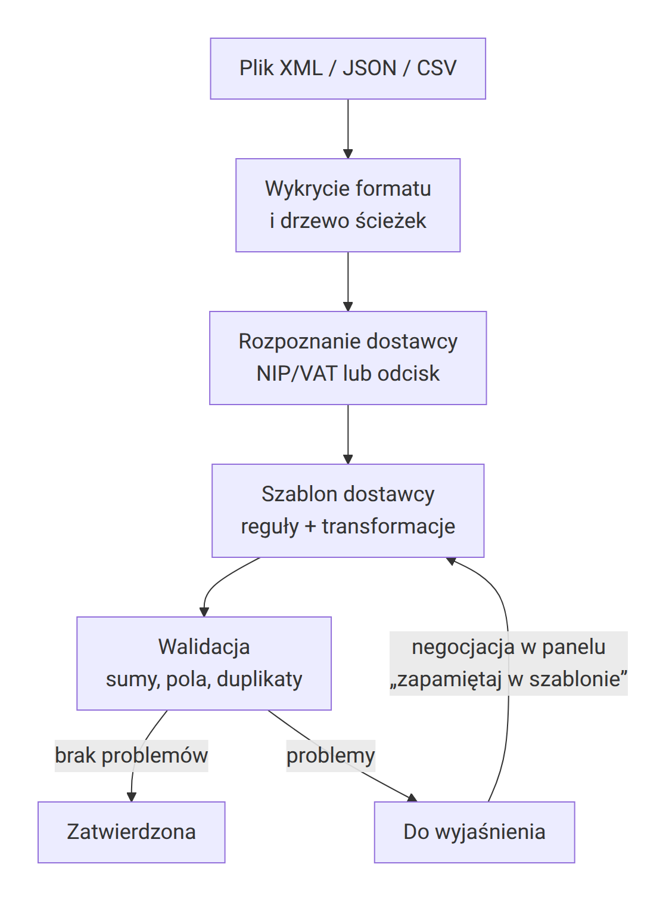
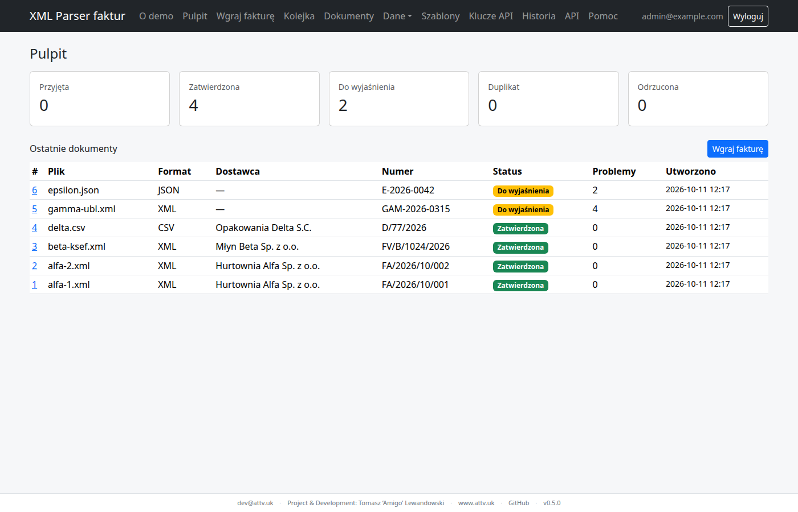

<!-- Wygenerowano przez tools/export_help.py z sekcji Pomoc w panelu — nie edytuj ręcznie. -->

# Jak to działa

Parser zamienia fakturę strukturalną dowolnego dostawcy na jeden **dokument kanoniczny** (ten sam zestaw pól dla wszystkich). Nie używa modeli językowych — działa na deterministycznych regułach i transformacjach z białej listy. Każdy dokument, niezależnie od tego, czy przyszedł z panelu, z REST API czy z edytora, przechodzi tę samą drogę.

## Krok po kroku

*Przebieg przetwarzania: plik XML, JSON lub CSV → wykrycie formatu i drzewo ścieżek → rozpoznanie dostawcy (NIP/VAT lub odcisk) → szablon → walidacja → „Zatwierdzona” albo „Do wyjaśnienia”; negocjacja w panelu z „zapamiętaj w szablonie” wraca do szablonu.*

1. **Wejście** — plik z panelu („Wgraj fakturę”) albo z API. Plik większy niż 10 MB jest odrzucany od razu. Plik zapisywany jest w magazynie plików, a dokument dostaje status „Przyjęta”.
2. **Wykrycie formatu** — po treści, nie po rozszerzeniu: plik zaczynający się od `<` to XML, od `{` lub `[` — JSON, pozostałe — CSV (separator `;`, `,`, tabulator lub `|` wykrywany automatycznie). Pliki puste, binarne (np. PDF, ZIP, obrazy) oraz w kodowaniu UTF-16/UTF-32 są odrzucane.
3. **Drzewo** — plik zamieniany jest na drzewo ścieżek, np. `Faktura/Naglowek/DostawcaNIP`. Przestrzenie nazw XML są pomijane (liczy się nazwa lokalna), atrybuty są osobnymi węzłami. Limit: 200 000 węzłów. XML z DOCTYPE/ENTITY jest odrzucany, encje nie są rozwijane, parser nie sięga do sieci.
4. **Identyfikacja dostawcy i odcisk** — system szuka NIP/VAT w ścieżkach znanych z aktywnych szablonów i w ścieżkach pasujących do słownika synonimów, a następnie porównuje go z NIP-ami dostawców. Szablon dostawcy wybierany jest po *odcisku* struktury: podobieństwie zbioru ścieżek pliku do ścieżek szablonu (co najmniej 60%). Gdy dostawca jest nieznany, a struktura pasuje do szablonu innego dostawcy, panel zaproponuje skopiowanie jego reguł.
5. **Szablon** — reguły *pole kanoniczne ← ścieżka w pliku → łańcuch transformacji*, plus wartości domyślne. Bez szablonu system tworzy *reguły robocze* na podstawie słownika synonimów (PL/EN/KSeF/UBL), typów wartości i reguł nauczonych u innych dostawców. Następnie rozpoznaje jednostki, przeliczniki i towary z kartoteki. Limit: 5 000 pozycji.
6. **Walidacja** — ilość × cena = netto i netto + VAT = brutto w pozycjach (ostrzeżenie), suma netto pozycji = netto faktury i netto + VAT = brutto faktury (blokuje); tolerancja 0,01. Na końcu sprawdzane są duplikaty.
7. **Status** — „Duplikat”, gdy faktura już jest w systemie; „Do wyjaśnienia”, gdy jest choć jeden problem blokujący; w przeciwnym razie „Zatwierdzona”. Problemy tego samego rodzaju z wielu pozycji są łączone w jeden (z licznikiem i numerami pierwszych 20 pozycji). Szczegóły: [Statusy i problemy](statusy-i-problemy.md).

## Co znaczy „uczenie”

System nie zgaduje w tle — uczy się wyłącznie z decyzji operatora. Gdy rozwiązując problem zaznaczysz **„Zapamiętaj w szablonie / słowniku dostawcy”**, decyzja zostaje zapisana tam, gdzie posłuży kolejnym fakturom:

- mapowanie pola → nowa [wersja szablonu](szablony.md) dostawcy;
- jednostka → alias jednostki tego dostawcy (np. `pcs` → `szt`);
- przelicznik → wpis w przelicznikach (zawsze zapamiętywany);
- towar → mapowanie towaru dostawcy (po kodzie, GTIN albo nazwie).

Reguły zapisane w szablonach podpowiadają też ścieżki dla *nowych* dostawców o podobnej strukturze plików. Bez zaznaczenia decyzja dotyczy **tylko tej faktury**.

*Pulpit po nauczeniu na alfa-1.xml: alfa-2.xml tego samego dostawcy zatwierdzona automatycznie, a pierwsze faktury nowych dostawców (gamma-ubl.xml, epsilon.json) czekają ze statusem „Do wyjaśnienia”.*
