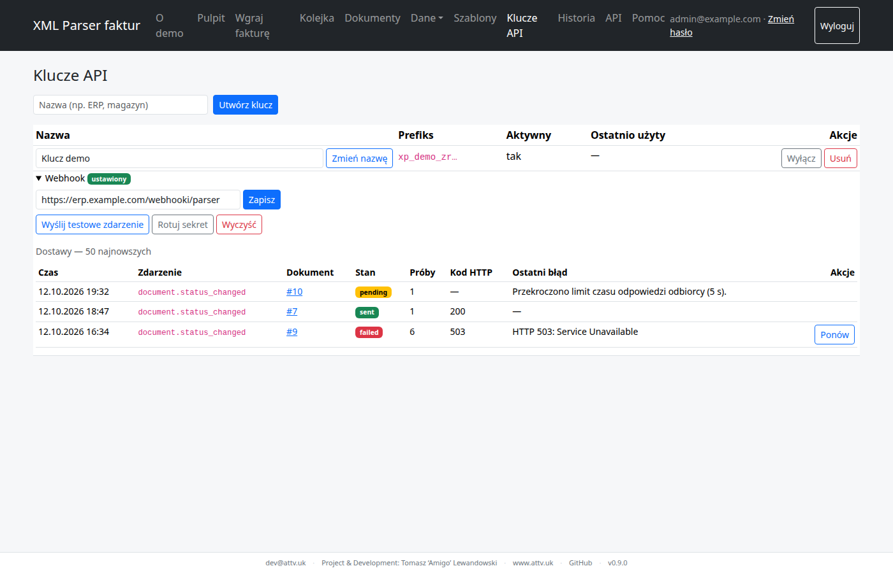

<!-- Wygenerowano przez tools/export_help.py z sekcji Pomoc w panelu — nie edytuj ręcznie. -->

# Webhooki

Webhook to powiadomienie, które parser sam wysyła do Twojego systemu, gdy zmieni się status dokumentu — na przykład gdy operator rozwiąże problemy w panelu i faktura zostanie zatwierdzona. Ten temat opisuje, jak go włączyć, co dokładnie przychodzi, jak sprawdzić podpis i co się dzieje, gdy Twój serwer nie odpowiada. Ogólny przebieg integracji (wysyłka, struktura wyniku) opisuje [Integracja z własną aplikacją](integracja.md).

<a id="po-co"></a>

## 1. Po co webhook

Bez webhooka o zmianie statusu dowiadujesz się, pytając API: synchronizacją listy (`updated_since` + `cursor`) albo odpytując dokument. Webhook odwraca kierunek: zamiast pytać co kilka minut, Twój system dostaje `POST` zaraz po zmianie — zwykle w ciągu kilku sekund.

- Powiadomienie mówi tylko, **że** status się zmienił (`id`, nowy i poprzedni status, czas). Fakturę pobierasz jak dotąd: `GET https://parser.example.com/api/v1/documents/{id}`.
- Zdarzenia dotyczą wyłącznie dokumentów wysłanych przez REST API **tym kluczem**, przy którym ustawiono webhook. Faktury wgrane w panelu i przykłady z trybu demo nie wysyłają powiadomień; klucz nieaktywny — też nie.
- Webhook nie zastępuje całkiem synchronizacji: gdy Twój serwer był długo niedostępny, jeden przebieg synchronizacji ([sposób B](integracja.md#synchronizacja)) wyrówna stan. Dobrą praktyką jest webhook do szybkiej reakcji plus rzadka synchronizacja, np. raz na dobę.

<a id="wlaczenie"></a>

## 2. Jak włączyć

Webhook ustawia się przy kluczu API w panelu, na stronie *Klucze API*. Zmieniać go może tylko użytkownik z rolą administratora.

1. Przy kluczu wpisz **adres webhooka** — adres Twojego serwera, który przyjmie `POST`, np. `https://erp.example.com/xp/webhook` — i zapisz.
2. Panel wygeneruje **sekret webhooka** i pokaże go **tylko raz**. Skopiuj go od razu do konfiguracji odbiorcy (w przykładach: zmienna `XP_WEBHOOK_SECRET`). Sekret nie pojawia się później nigdzie: ani w panelu, ani w Historii, ani w API.
3. Kliknij „Wyślij testowe zdarzenie”. Parser od razu wyśle zdarzenie `webhook.test`, a wynik (kod odpowiedzi albo błąd) zobaczysz na liście dostaw przy kluczu.

Zgubiony lub ujawniony sekret wymienisz przyciskiem „Rotuj sekret” — nowy sekret też jest pokazywany raz, a stary przestaje działać od razu, także dla dostaw czekających na ponowienie. „Wyczyść” wyłącza webhook: usuwa adres i sekret. Pod ustawieniami jest lista 50 najnowszych dostaw z kluczem: stan, liczba prób, ostatni błąd i przycisk „Ponów”.



*Strona Klucze API: przy kluczu sekcja webhooka — adres, przyciski „Rotuj sekret”, „Wyczyść” i „Wyślij testowe zdarzenie” oraz lista najnowszych dostaw ze stanem, liczbą prób, ostatnim błędem i przyciskiem „Ponów”.*

<a id="zdarzenie"></a>

## 3. Co przychodzi

Parser wysyła `POST` na Twój adres z JSON-em w ciele. Zdarzenia są dwa:

- `document.status_changed` — status dokumentu się zmienił: przy przyjęciu pliku (z `received` na wynik przetwarzania), po decyzjach operatora w panelu, „Przetwórz ponownie”, `reprocess` przez API, „Odrzuć” i „Przywróć”. Ponowne przetworzenie, po którym status jest taki sam, nie wysyła zdarzenia.
- `webhook.test` — zdarzenie próbne z przycisku „Wyślij testowe zdarzenie”; ma te same pola, ale pola dokumentu są puste (`null`).

```json
{
  "document_url": "https://parser.example.com/dokumenty/42",
  "event": "document.status_changed",
  "id": 42,
  "previous_status": "needs_review",
  "status": "approved",
  "updated_at": "2026-10-12T09:15:02.123456Z"
}
```

| Pole | Znaczenie |
| --- | --- |
| `event` | `document.status_changed` albo `webhook.test` |
| `id` | identyfikator dokumentu — ten sam, który dostałeś w odpowiedzi `201` |
| `status`, `previous_status` | nowy i poprzedni status (kody jak w API: `received`, `approved`, `needs_review`, `duplicate`, `rejected`) |
| `updated_at` | chwila zmiany — ten sam format co w API (UTC z mikrosekundami i `Z`) |
| `document_url` | adres dokumentu w panelu (dla człowieka); może być `null` — patrz „Eksploatacja” |

Ciało jest wysyłane zwięźle — bez spacji, z kluczami w kolejności alfabetycznej. Każde żądanie ma trzy własne nagłówki parsera (wartości przykładowe; czas i podpis pochodzą z wektora testowego z rozdziału 4, nie z ładunku powyżej):

```text
X-XP-Timestamp: 1760000000
X-XP-Signature: sha256=3bbaa1b01d7597a96349f290bbb59f27e7fdfe7d4918adbf949e7c3379973d46
X-XP-Delivery: 0b6f3c1e-8d2a-4f47-9a51-2c7e5d9b1a03
```

Poza nimi żądanie ma zwykłe nagłówki `Content-Type: application/json` i `User-Agent: xml-parser-webhook/<wersja>`.

- `X-XP-Timestamp` — czas wysyłki w sekundach unixowych (tekst);
- `X-XP-Signature` — `sha256=<hex HMAC-SHA256(sekret, "<timestamp>.<ciało>")>`;
- `X-XP-Delivery` — identyfikator dostawy (UUID), **taki sam przy każdym ponowieniu** tej samej dostawy — to Twój klucz idempotencji.

Kolejność powiadomień nie jest gwarantowana (ponowienie starszej dostawy może przyjść po nowszej), a to samo zdarzenie może przyjść więcej niż raz. Porównuj `updated_at` z tym, co już masz, a w razie wątpliwości pobierz dokument z API — tam jest zawsze stan aktualny.

<a id="podpis"></a>

## 4. Jak zweryfikować podpis

Każde żądanie sprawdź, zanim cokolwiek przetworzysz — tylko tak masz pewność, że wysłał je parser:

1. Odczytaj **surowe bajty ciała** (nie parsuj i nie serializuj JSON-a od nowa przed sprawdzeniem).
2. Odrzuć żądanie, którego `X-XP-Timestamp` różni się od Twojego zegara o więcej niż 300 s.
3. Policz HMAC-SHA256 sekretem z tekstu `<X-XP-Timestamp>.<ciało>`, zapisz szesnastkowo z przedrostkiem `sha256=` i porównaj z `X-XP-Signature` w stałym czasie. Niezgodność → `401`.
4. Odpowiedz szybko `2xx` (limit to 5 s), a dłuższą pracę — np. pobranie faktury — wykonaj w tle.

Gotowi odbiorcy poniżej robią to wszystko. Sekret czytają ze zmiennej `XP_WEBHOOK_SECRET`. Działają w dwóch trybach: serwer HTTP (Python, PHP, Node.js; powłoka — tylko `--check`) oraz `--check <ts> <podpis>` — sprawdzenie podpisu ciała podanego na wejściu, bez sieci, z wynikiem `OK` (kod 0) albo powodem odrzucenia (kod 1). Opcja `--now <ts>` podstawia czas zamiast zegara systemowego. Wektor do sprawdzenia własnej implementacji — sekret `whsec_test_0123456789abcdef`, czas `1760000000`, ciało `{"event":"webhook.test","id":null}`:

```bash
export XP_WEBHOOK_SECRET='whsec_test_0123456789abcdef'
printf '%s' '{"event":"webhook.test","id":null}' \
  | python3 webhook-odbiorca.py --check 1760000000 \
      sha256=3bbaa1b01d7597a96349f290bbb59f27e7fdfe7d4918adbf949e7c3379973d46 --now 1760000000
# → OK (kod 0); zmień jeden znak ciała albo podpisu, a odbiorca wypisze powód odrzucenia (kod 1)

export XP_WEBHOOK_SECRET='…'   # Twój sekret z „Klucze API”
python3 webhook-odbiorca.py --port 9000              # serwer: Python
XP_WEBHOOK_SECRET='…' php -S 0.0.0.0:9000 webhook-odbiorca.php   # serwer: PHP
node webhook-odbiorca.mjs --port 9000                # serwer: Node.js
```

**Powtórzenia i replay.** Podpis obejmuje czas i ciało, ale nie `X-XP-Delivery`, więc w oknie 300 s ktoś, kto przechwycił żądanie, mógłby je odtworzyć. Zapamiętuj identyfikatory `X-XP-Delivery` trwale (np. tabela z unikalnym kluczem albo Redis z czasem życia dłuższym niż 300 s) i powtórzony identyfikator traktuj jak sukces: `200` bez ponownego przetwarzania. Deduplikuj **dopiero po** poprawnej weryfikacji podpisu — inaczej żądanie bez sekretu mogłoby „zająć” identyfikator prawdziwej dostawy.

<a id="odbiorca-python"></a>

### Python (stdlib)

```python
#!/usr/bin/env python3
"""Odbiorca webhooka parsera faktur — Python, tylko biblioteka standardowa.

Parser wysyła POST z JSON-em i nagłówkami:
  X-XP-Timestamp  czas wysyłki (sekundy unixowe, tekst)
  X-XP-Signature  sha256=<hex HMAC-SHA256(sekret, "<timestamp>.<surowe bajty ciała>")>
  X-XP-Delivery   identyfikator dostawy (UUID) — taki sam przy ponowieniach; użyj go jako klucza idempotencji

Sekret bierz ze zmiennej XP_WEBHOOK_SECRET (nie wpisuj go w kodzie).

Ochrona przed powtórzeniem (replay): podpis obejmuje tylko „<timestamp>.<ciało>”, bez nagłówka X-XP-Delivery,
więc w oknie ±300 s identyczne żądanie można przesłać ponownie. Deduplikuj po X-XP-Delivery WYŁĄCZNIE PO
pozytywnej weryfikacji podpisu (inaczej ktoś bez sekretu mógłby „zająć” cudzy identyfikator), przechowuj
widziane identyfikatory trwale (np. tabela webhook_deliveries_seen z unikalnym kluczem albo zbiór w Redis
z TTL > 300 s) i powtórzony identyfikator traktuj jak sukces: odpowiedz 200 bez ponownego przetwarzania.

Tryby:
  python3 webhook-odbiorca.py --port 9000                        serwer HTTP (domyślnie port 9000)
  python3 webhook-odbiorca.py --check <ts> <podpis> < ciało.json weryfikacja bez sieci: OK / powód, kod 0 / 1
                                                                 (opcjonalnie --now <ts> zamiast zegara systemowego)
"""
import argparse
import hashlib
import hmac
import json
import os
import sys
import time
from http.server import BaseHTTPRequestHandler, ThreadingHTTPServer

MAX_BODY = 1024 * 1024  # 1 MiB: większe ciało odrzucamy (413) bez czytania
MAX_SKEW = 300  # sekundy: starsze lub „z przyszłości” żądania odrzucamy (ochrona przed powtórzeniem)


def verify(secret: str, timestamp: str, signature: str, body: bytes, now: int | None = None) -> str | None:
    """None, gdy podpis jest poprawny; w przeciwnym razie powód odrzucenia (po polsku)."""
    try:
        sent = int(timestamp)
    except (TypeError, ValueError):
        return "nieprawidłowy znacznik czasu"
    if abs((int(time.time()) if now is None else now) - sent) > MAX_SKEW:
        return f"znacznik czasu poza dopuszczalnym oknem {MAX_SKEW} s"
    # Podpis liczymy z SUROWYCH bajtów ciała — nie z ponownie zserializowanego JSON-a.
    expected = "sha256=" + hmac.new(secret.encode(), timestamp.encode() + b"." + body, hashlib.sha256).hexdigest()
    if not hmac.compare_digest(expected, signature or ""):  # porównanie w stałym czasie
        return "nieprawidłowy podpis"
    return None


class Handler(BaseHTTPRequestHandler):
    secret = ""
    seen: set[str] = set()  # ilustracja; w produkcji trwały magazyn (tabela / Redis), nie pamięć procesu

    def do_POST(self):
        try:
            length = int(self.headers.get("Content-Length", ""))
        except ValueError:
            return self.reply(411, "wymagany poprawny nagłówek Content-Length")
        if length < 0:
            return self.reply(400, "nieprawidłowy Content-Length")
        if length > MAX_BODY:
            return self.reply(413, "ciało zbyt duże")
        body = self.rfile.read(length)
        reason = verify(self.secret, self.headers.get("X-XP-Timestamp", ""),
                        self.headers.get("X-XP-Signature", ""), body)
        if reason:
            print(f"odrzucono: {reason}", flush=True)
            return self.reply(401, reason)
        # Dopiero po weryfikacji przetwarzamy treść. Odpowiadaj szybko (2xx); ciężką pracę zlecaj w tle.
        # Dostawa może przyjść ponownie z tym samym X-XP-Delivery — zapisuj go i pomijaj duplikaty.
        try:
            data = json.loads(body)
        except ValueError:
            return self.reply(400, "ciało nie jest JSON-em")
        if not isinstance(data, dict):
            return self.reply(400, "ciało musi być obiektem JSON")
        delivery = self.headers.get("X-XP-Delivery", "")
        if delivery in self.seen:  # powtórzona dostawa: sukces bez ponownego przetwarzania
            return self.reply(200, "ok (duplikat)")
        self.seen.add(delivery)
        if data.get("event") == "webhook.test":
            print("test OK", flush=True)
        else:
            print(f"event={data.get('event')} id={data.get('id')} status={data.get('status')} "
                  f"delivery={delivery}", flush=True)
        self.reply(200, "ok")

    def reply(self, code: int, text: str):
        payload = text.encode()
        self.send_response(code)
        self.send_header("Content-Type", "text/plain; charset=utf-8")
        self.send_header("Content-Length", str(len(payload)))
        self.end_headers()
        self.wfile.write(payload)

    def log_message(self, *args):
        pass  # własne wiersze dziennika wyżej


def main() -> int:
    parser = argparse.ArgumentParser(description=__doc__, formatter_class=argparse.RawDescriptionHelpFormatter)
    parser.add_argument("--check", nargs=2, metavar=("TS", "PODPIS"), help="zweryfikuj ciało ze stdin i zakończ")
    parser.add_argument("--now", type=int, help="z --check: bieżący czas (sekundy unixowe) zamiast zegara")
    parser.add_argument("--port", type=int, default=9000)
    args = parser.parse_args()
    secret = os.environ.get("XP_WEBHOOK_SECRET", "")
    if not secret:
        print("Ustaw zmienną XP_WEBHOOK_SECRET (sekret webhooka z panelu).", file=sys.stderr)
        return 2
    if args.check:
        reason = verify(secret, args.check[0], args.check[1], sys.stdin.buffer.read(), args.now)
        print(reason or "OK")
        return 1 if reason else 0
    Handler.secret = secret
    print(f"Nasłuch na porcie {args.port} (Ctrl+C kończy)", flush=True)
    ThreadingHTTPServer(("0.0.0.0", args.port), Handler).serve_forever()
    return 0


if __name__ == "__main__":
    sys.exit(main())
```

<a id="odbiorca-php"></a>

### PHP

```php
<?php
// Odbiorca webhooka parsera faktur — PHP 8+, jeden plik, bez zależności.
//
// Parser wysyła POST z JSON-em i nagłówkami:
//   X-XP-Timestamp  czas wysyłki (sekundy unixowe, tekst)
//   X-XP-Signature  sha256=<hex HMAC-SHA256(sekret, "<timestamp>.<surowe bajty ciała>")>
//   X-XP-Delivery   identyfikator dostawy (UUID) — taki sam przy ponowieniach; użyj go jako klucza idempotencji
//
// Sekret bierz ze zmiennej XP_WEBHOOK_SECRET (nie wpisuj go w kodzie).
//
//
// Ochrona przed powtórzeniem (replay): podpis obejmuje tylko „<timestamp>.<ciało>”, bez nagłówka X-XP-Delivery,
// więc w oknie ±300 s identyczne żądanie można przesłać ponownie. Deduplikuj po X-XP-Delivery WYŁĄCZNIE PO
// pozytywnej weryfikacji podpisu (inaczej ktoś bez sekretu mógłby „zająć” cudzy identyfikator), przechowuj
// widziane identyfikatory trwale (np. tabela webhook_deliveries_seen z unikalnym kluczem albo zbiór w Redis
// z TTL > 300 s) i powtórzony identyfikator traktuj jak sukces: odpowiedz 200 bez ponownego przetwarzania.
//
// Rozmiar ciała ogranicza dyrektywa post_max_size (php.ini); PHP odrzuci większe żądania przed skryptem.
//
// Tryby:
//   XP_WEBHOOK_SECRET=... php -S 0.0.0.0:9000 webhook-odbiorca.php     serwer HTTP (wbudowany serwer PHP)
//   php webhook-odbiorca.php --check <ts> <podpis> < ciało.json        weryfikacja bez sieci: OK / powód, kod 0 / 1
//                                                                      (opcjonalnie --now <ts> zamiast zegara)

const MAX_SKEW = 300; // sekundy: starsze lub „z przyszłości” żądania odrzucamy (ochrona przed powtórzeniem)

/** null, gdy podpis jest poprawny; w przeciwnym razie powód odrzucenia (po polsku). */
function verify(string $secret, string $timestamp, string $signature, string $body, ?int $now = null): ?string
{
    if (!preg_match('/^-?\d+$/', $timestamp)) {
        return 'nieprawidłowy znacznik czasu';
    }
    if (abs(($now ?? time()) - (int) $timestamp) > MAX_SKEW) {
        return 'znacznik czasu poza dopuszczalnym oknem ' . MAX_SKEW . ' s';
    }
    // Podpis liczymy z SUROWYCH bajtów ciała — nie z ponownie zserializowanego JSON-a.
    $expected = 'sha256=' . hash_hmac('sha256', $timestamp . '.' . $body, $secret);
    if (!hash_equals($expected, $signature)) { // porównanie w stałym czasie
        return 'nieprawidłowy podpis';
    }
    return null;
}

$secret = getenv('XP_WEBHOOK_SECRET') ?: '';

if (PHP_SAPI === 'cli') {
    if ($secret === '') {
        fwrite(STDERR, "Ustaw zmienną XP_WEBHOOK_SECRET (sekret webhooka z panelu).\n");
        exit(2);
    }
    $at = array_search('--check', $argv, true);
    if ($at === false) {
        fwrite(STDERR, "Serwer: XP_WEBHOOK_SECRET=... php -S 0.0.0.0:9000 webhook-odbiorca.php\n"
            . "Weryfikacja: php webhook-odbiorca.php --check <ts> <podpis> < ciało.json\n");
        exit(2);
    }
    $nowAt = array_search('--now', $argv, true);
    $reason = verify($secret, $argv[$at + 1] ?? '', $argv[$at + 2] ?? '', stream_get_contents(STDIN),
        $nowAt === false ? null : (int) ($argv[$nowAt + 1] ?? 0));
    echo ($reason ?? 'OK') . "\n";
    exit($reason === null ? 0 : 1);
}

// --- tryb serwera (php -S) ---
function reply(int $code, string $text): void
{
    http_response_code($code);
    header('Content-Type: text/plain; charset=utf-8');
    echo $text;
}

function log_line(string $line): void
{
    file_put_contents('php://stderr', $line . "\n"); // wbudowany serwer pokazuje stderr w konsoli
}

if ($secret === '') {
    return reply(500, 'brak XP_WEBHOOK_SECRET');
}
if ($_SERVER['REQUEST_METHOD'] !== 'POST') {
    return reply(405, 'tylko POST');
}
$body = file_get_contents('php://input'); // surowe bajty
$reason = verify($secret, $_SERVER['HTTP_X_XP_TIMESTAMP'] ?? '', $_SERVER['HTTP_X_XP_SIGNATURE'] ?? '', $body);
if ($reason !== null) {
    log_line("odrzucono: $reason");
    return reply(401, $reason);
}
// Dopiero po weryfikacji przetwarzamy treść. Odpowiadaj szybko (2xx); ciężką pracę zlecaj w tle.
// Dostawa może przyjść ponownie z tym samym X-XP-Delivery — zapisuj go i pomijaj duplikaty.
$data = json_decode($body, true);
if (!is_array($data)) {
    return reply(400, 'ciało nie jest JSON-em');
}
// Dedup po X-XP-Delivery (po weryfikacji podpisu!): tu zapisz id w trwałym magazynie (tabela z unikalnym kluczem);
// jeśli już jest — odpowiedz 200 bez przetwarzania. Wbudowany serwer nie trzyma stanu między żądaniami.
if (($data['event'] ?? null) === 'webhook.test') {
    log_line('test OK');
} else {
    log_line(sprintf('event=%s id=%s status=%s delivery=%s', $data['event'] ?? '', $data['id'] ?? '',
        $data['status'] ?? '', $_SERVER['HTTP_X_XP_DELIVERY'] ?? ''));
}
reply(200, 'ok');
```

<a id="odbiorca-javascript"></a>

### Node.js

```javascript
#!/usr/bin/env node
// Odbiorca webhooka parsera faktur — Node.js 18+ (node:http, node:crypto, bez zależności).
//
// Parser wysyła POST z JSON-em i nagłówkami:
//   X-XP-Timestamp  czas wysyłki (sekundy unixowe, tekst)
//   X-XP-Signature  sha256=<hex HMAC-SHA256(sekret, "<timestamp>.<surowe bajty ciała>")>
//   X-XP-Delivery   identyfikator dostawy (UUID) — taki sam przy ponowieniach; użyj go jako klucza idempotencji
//
// Sekret bierz ze zmiennej XP_WEBHOOK_SECRET (nie wpisuj go w kodzie).
//
//
// Ochrona przed powtórzeniem (replay): podpis obejmuje tylko „<timestamp>.<ciało>”, bez nagłówka X-XP-Delivery,
// więc w oknie ±300 s identyczne żądanie można przesłać ponownie. Deduplikuj po X-XP-Delivery WYŁĄCZNIE PO
// pozytywnej weryfikacji podpisu (inaczej ktoś bez sekretu mógłby „zająć” cudzy identyfikator), przechowuj
// widziane identyfikatory trwale (np. tabela webhook_deliveries_seen z unikalnym kluczem albo zbiór w Redis
// z TTL > 300 s) i powtórzony identyfikator traktuj jak sukces: odpowiedz 200 bez ponownego przetwarzania.
//
// Tryby:
//   node webhook-odbiorca.mjs --port 9000                          serwer HTTP (domyślnie port 9000)
//   node webhook-odbiorca.mjs --check <ts> <podpis> < ciało.json   weryfikacja bez sieci: OK / powód, kod 0 / 1
//                                                                  (opcjonalnie --now <ts> zamiast zegara)
import { createHmac, timingSafeEqual } from "node:crypto";
import { createServer } from "node:http";

const MAX_BODY = 1024 * 1024; // 1 MiB: większe ciało odrzucamy (413)
const seen = new Set(); // ilustracja; w produkcji trwały magazyn (tabela / Redis), nie pamięć procesu
const MAX_SKEW = 300; // sekundy: starsze lub „z przyszłości” żądania odrzucamy (ochrona przed powtórzeniem)

/** null, gdy podpis jest poprawny; w przeciwnym razie powód odrzucenia (po polsku). */
function verify(secret, timestamp, signature, body, now = Math.floor(Date.now() / 1000)) {
  if (!/^-?\d+$/.test(timestamp ?? "")) return "nieprawidłowy znacznik czasu";
  if (Math.abs(now - Number(timestamp)) > MAX_SKEW) return `znacznik czasu poza dopuszczalnym oknem ${MAX_SKEW} s`;
  // Podpis liczymy z SUROWYCH bajtów ciała (Buffer) — nie z ponownie zserializowanego JSON-a.
  const mac = createHmac("sha256", secret).update(`${timestamp}.`).update(body).digest("hex");
  const expected = Buffer.from(`sha256=${mac}`);
  const given = Buffer.from(signature ?? "");
  // timingSafeEqual wymaga równych długości; porównanie w stałym czasie
  if (given.length !== expected.length || !timingSafeEqual(given, expected)) return "nieprawidłowy podpis";
  return null;
}

async function readBody(stream, limit = Infinity) {
  const chunks = [];
  let size = 0;
  for await (const chunk of stream) {
    size += chunk.length;
    if (size > limit) throw new RangeError("za duże ciało");
    chunks.push(chunk);
  }
  return Buffer.concat(chunks);
}

function option(args, name) {
  const i = args.indexOf(name);
  return i === -1 ? undefined : args[i + 1];
}

const args = process.argv.slice(2);
const secret = process.env.XP_WEBHOOK_SECRET ?? "";
if (!secret) {
  console.error("Ustaw zmienną XP_WEBHOOK_SECRET (sekret webhooka z panelu).");
  process.exit(2);
}

const checkAt = args.indexOf("--check");
if (checkAt !== -1) {
  const now = option(args, "--now");
  const reason = verify(secret, args[checkAt + 1], args[checkAt + 2], await readBody(process.stdin),
    now === undefined ? undefined : Number(now));
  console.log(reason ?? "OK");
  process.exit(reason ? 1 : 0);
}

const port = Number(option(args, "--port") ?? 9000);
createServer(async (req, res) => {
  const reply = (code, text) => { res.writeHead(code, { "Content-Type": "text/plain; charset=utf-8" }); res.end(text); };
  try {
    if (req.method !== "POST") return reply(405, "tylko POST");
    let body;
    try { body = await readBody(req, MAX_BODY); } catch { return reply(413, "ciało zbyt duże"); }
    const reason = verify(secret, req.headers["x-xp-timestamp"], req.headers["x-xp-signature"], body);
    if (reason) {
      console.log(`odrzucono: ${reason}`);
      return reply(401, reason);
    }
    // Dopiero po weryfikacji przetwarzamy treść. Odpowiadaj szybko (2xx); ciężką pracę zlecaj w tle.
    let data;
    try { data = JSON.parse(body.toString("utf8")); } catch { return reply(400, "ciało nie jest JSON-em"); }
    if (typeof data !== "object" || data === null || Array.isArray(data)) return reply(400, "ciało musi być obiektem JSON");
    const delivery = req.headers["x-xp-delivery"] ?? "";
    if (seen.has(delivery)) return reply(200, "ok (duplikat)"); // powtórzona dostawa: sukces bez przetwarzania
    seen.add(delivery);
    if (data.event === "webhook.test") console.log("test OK");
    else console.log(`event=${data.event} id=${data.id} status=${data.status} delivery=${delivery}`);
    reply(200, "ok");
  } catch (err) { // nieoczekiwany błąd nie może zabić procesu; parser ponowi dostawę
    console.error(err);
    if (!res.headersSent) reply(500, "błąd wewnętrzny");
  }
}).listen(port, () => console.log(`Nasłuch na porcie ${port} (Ctrl+C kończy)`));
```

<a id="odbiorca-bash"></a>

### bash

```bash
#!/usr/bin/env bash
# Odbiorca webhooka parsera faktur — powłoka + openssl: TYLKO weryfikacja podpisu (--check).
#
# Parser wysyła POST z JSON-em i nagłówkami:
#   X-XP-Timestamp  czas wysyłki (sekundy unixowe, tekst)
#   X-XP-Signature  sha256=<hex HMAC-SHA256(sekret, "<timestamp>.<surowe bajty ciała>")>
#   X-XP-Delivery   identyfikator dostawy (UUID) — taki sam przy ponowieniach
#
# Sekret bierz ze zmiennej XP_WEBHOOK_SECRET.
#
#
# Ochrona przed powtórzeniem (replay): podpis obejmuje tylko „<timestamp>.<ciało>”, bez nagłówka X-XP-Delivery,
# więc w oknie ±300 s identyczne żądanie można przesłać ponownie. Deduplikuj po X-XP-Delivery WYŁĄCZNIE PO
# pozytywnej weryfikacji podpisu (inaczej ktoś bez sekretu mógłby „zająć” cudzy identyfikator), przechowuj
# widziane identyfikatory trwale (np. tabela webhook_deliveries_seen z unikalnym kluczem albo zbiór w Redis
# z TTL > 300 s) i powtórzony identyfikator traktuj jak sukces: odpowiedz 200 bez ponownego przetwarzania.
#
# Użycie:  ./webhook-odbiorca.sh --check <ts> <podpis> [--now <ts>] < ciało.json
# Wypisuje OK albo powód odrzucenia; kod wyjścia 0 / 1. Bez sieci.
#
# Uwaga: bash nie ma serwera HTTP — do odbioru żądań użyj odbiorcy w Pythonie, PHP lub Node.js.
# Uwaga: porównanie tekstów w bashu nie jest w stałym czasie; dla narzędzia do ręcznego sprawdzania
# podpisu jest to akceptowalne, w prawdziwym odbiorcy użyj hmac.compare_digest / hash_equals / timingSafeEqual.
set -euo pipefail

MAX_SKEW=300

if [[ "${1:-}" != "--check" || $# -lt 3 ]]; then
  echo "Użycie: $0 --check <ts> <podpis> [--now <ts>] < ciało.json" >&2
  echo "Ten skrypt tylko weryfikuje podpis; serwer HTTP wymaga innego środowiska (Python, PHP, Node.js)." >&2
  exit 2
fi
ts="$2"
signature="$3"
now="$(date +%s)"
if [[ "${4:-}" == "--now" ]]; then now="${5:-}"; fi

if [[ -z "${XP_WEBHOOK_SECRET:-}" ]]; then
  echo "Ustaw zmienną XP_WEBHOOK_SECRET (sekret webhooka z panelu)." >&2
  exit 2
fi
# Do 12 cyfr: dłuższa liczba przepełniłaby arytmetykę basha (64 bity) i zafałszowała różnicę czasu.
if [[ ! "$ts" =~ ^-?[0-9]{1,12}$ || ! "$now" =~ ^-?[0-9]{1,12}$ ]]; then
  echo "nieprawidłowy znacznik czasu"
  exit 1
fi
skew=$(( now - ts ))
if (( skew < 0 )); then skew=$(( -skew )); fi
if (( skew > MAX_SKEW )); then
  echo "znacznik czasu poza dopuszczalnym oknem ${MAX_SKEW} s"
  exit 1
fi

# Dopisek „x” chroni końcowe znaki nowej linii ciała przed obcięciem przez $(...) — podpis dotyczy surowych bajtów.
body="$(cat; printf x)"
body="${body%x}"
if command -v python3 >/dev/null 2>&1; then
  # Preferowane: sekret zostaje w środowisku procesu i nie trafia do argv (nie widać go w `ps`).
  mac="$(printf '%s.%s' "$ts" "$body" | python3 -I -c '
import hashlib, hmac, os, sys
print(hmac.new(os.environ["XP_WEBHOOK_SECRET"].encode(), sys.stdin.buffer.read(), hashlib.sha256).hexdigest())')"
else
  # UWAGA: w tej gałęzi sekret jest argumentem openssl, więc inni użytkownicy hosta zobaczą go w `ps`.
  # Skrypt służy do lokalnych sprawdzeń; na współdzielonym hoście zainstaluj python3 albo użyj innego odbiorcy.
  mac="$(printf '%s.%s' "$ts" "$body" | openssl dgst -sha256 -hmac "$XP_WEBHOOK_SECRET" | sed 's/^.*= //')"
fi
if [[ "sha256=$mac" == "$signature" ]]; then
  echo "OK"
else
  echo "nieprawidłowy podpis"
  exit 1
fi
```

<a id="ponowienia"></a>

## 5. Ponowienia i stany dostaw

Za dostarczone uznawana jest tylko odpowiedź `2xx`. Każda inna odpowiedź, przekierowanie (parser nie idzie za `3xx`), błąd sieci i brak odpowiedzi w ciągu 5 s to porażka. Po kolejnych porażkach parser ponawia wysyłkę po 1 min, 5 min, 30 min, 2 h i 12 h — razem 6 prób w ciągu mniej więcej 15 godzin.

| Stan dostawy | Znaczenie |
| --- | --- |
| `pending` | czeka na wysyłkę albo na kolejną próbę |
| `sent` | dostarczona — odbiorca odpowiedział `2xx` |
| `failed` | 6. próba też się nie udała (albo klucz wyłączono lub usunięto adres webhooka) — parser już nie ponawia |

Dostawę `failed` wznowisz przyciskiem „Ponów” przy dostawie na stronie *Klucze API*: licznik prób zaczyna się od nowa, a dostawa ma ten sam `X-XP-Delivery`. Przy każdej wysyłce adres jest sprawdzany od nowa (rozdział 6), a podpis liczony aktualnym sekretem.

<a id="cel"></a>

## 6. Bezpieczeństwo adresu docelowego

Żeby webhook nie mógł posłużyć do sięgania w głąb sieci serwera parsera, adres musi spełniać kilka warunków — sprawdzanych przy zapisie i ponownie przy każdej wysyłce:

- tylko `https`; `http` dopuszcza dopiero `WEBHOOK_ALLOW_HTTP=1` — wyłącznie do testów albo w zamkniętej sieci wewnętrznej;
- bez adresów niepublicznych: prywatnych (np. `10.0.0.0/8`, `192.168.0.0/16`), lokalnych (`127.0.0.1`, `::1`), link-local (w tym `169.254.169.254`) i CGNAT (`100.64.0.0/10`, m.in. Tailscale). Liczą się wszystkie adresy, które zwraca DNS — wystarczy jeden zablokowany;
- bez danych logowania w adresie (`user:hasło@`) i bez fragmentu (`#…`); najwyżej 500 znaków.

Odbiorca w sieci firmowej albo w tailnecie? Administrator instancji dopisuje go do zmiennej `WEBHOOK_ALLOWED_HOSTS`: nazwy hostów i podsieci CIDR rozdzielone przecinkami, np. `WEBHOOK_ALLOWED_HOSTS=erp.local,10.20.0.0/16`. Wyjątek zdejmuje tylko blokadę adresu — wymóg `https` zostaje.

<a id="lista-dostaw"></a>

## 7. Lista dostaw w API

Historię dostaw swojego klucza pobierzesz bez panelu: `GET /api/v1/webhook-deliveries`.

```bash
curl -H "X-API-Key: $XP_API_KEY" "https://parser.example.com/api/v1/webhook-deliveries?status=failed&limit=50"
```

- Parametry: `status` (`pending`, `sent` albo `failed`), `document_id`, `limit` (domyślnie 100, maks. 500) i `cursor`. Wyniki od najnowszych; gdy jest ich więcej, `next_cursor` wskazuje następną stronę (powtórz filtry i dodaj `cursor=<next_cursor>`; `null` — ostatnia strona).
- Pola dostawy: `uuid` (to samo co `X-XP-Delivery`), `event`, `status`, `attempts`, `document_id`, `payload` (wysyłane zdarzenie), `created_at`, `next_attempt_at`, `sent_at`, `last_status_code`, `last_error`.
- Klucz widzi tylko swoje dostawy; sekretu nie ma w żadnej odpowiedzi. Pełny opis: dokumentacja interaktywna (`/api/docs`).

<a id="eksploatacja"></a>

## 8. Eksploatacja (administrator instancji)

- **Worker.** Powiadomienia wysyła osobna usługa Docker Compose `worker` (polecenie `flask webhooks-worker`, sprawdza kolejkę co 5 s). Stan sprawdzisz poleceniem `docker compose ps` — `worker` powinien być `healthy`. Gdy nie działa, dostawy czekają w stanie `pending`; awaryjnie wyślesz je z crona poleceniem `flask webhooks-worker --once` (jeden przebieg i koniec).
- **`PUBLIC_BASE_URL`** — publiczny adres panelu (np. `https://faktury.example.com`) używany w `document_url`. Bez niego trafia tam adres żądania, które zmieniło status (może być wewnętrzny), a przy zmianach poza żądaniem HTTP — `null`.
- **Retencja.** `flask prune-webhooks` usuwa dostawy zakończone (`sent`, `failed`) starsze niż `WEBHOOK_RETENTION_DAYS` dni (domyślnie 30; inna wartość: `--days N`). Uruchamiaj je z crona, np. raz na dobę.
- **Adresy docelowe**: `WEBHOOK_ALLOWED_HOSTS` i `WEBHOOK_ALLOW_HTTP` (rozdział 6). Wszystkie zmienne opisuje `.env.example`.
