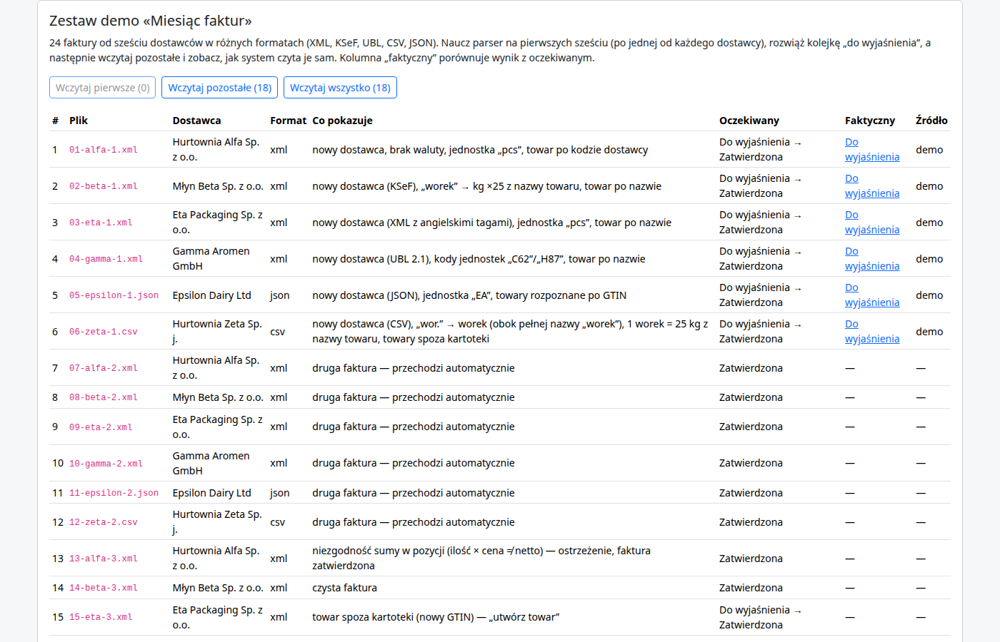

<!-- Wygenerowano przez tools/export_help.py z sekcji Pomoc w panelu — nie edytuj ręcznie. -->

# Zestaw demo „Miesiąc faktur”

Zestaw demo „Miesiąc faktur” to **24 fikcyjne faktury** z jednego miesiąca (październik 2026) od **sześciu dostawców**: Alfa, Beta, Gamma, Epsilon, Zeta i Eta. Są w różnych formatach (XML, KSeF, UBL, JSON, CSV). Dzięki nim zobaczysz całą pracę systemu: pierwsze faktury trzeba wyjaśnić, a kolejne tych samych dostawców przechodzą same.



*Karta „Zestaw demo” na stronie „O demo”: przyciski „Wczytaj pierwsze”, „Wczytaj pozostałe” i „Wczytaj wszystko”, a pod nimi tabela 24 faktur z oczekiwanym i faktycznym statusem każdej z nich.*

## Krok po kroku

1. **„Wczytaj pierwsze (6)”.** Wczytuje po jednej fakturze każdego dostawcy. Wszystkie sześć trafia do [Kolejki](pierwsza-faktura.md) ze statusem „Do wyjaśnienia”, bo to nowi dostawcy. Otwórz każdą i rozwiąż problemy od góry. Pierwsze podpowiedzi są prawie zawsze dobre — **poza jedną: dla Epsilon wybierz walutę GBP, nie pierwszą podpowiedź PLN**. Epsilon rozlicza się w funtach, a PLN jest tylko walutą domyślną systemu; zostaw „zapamiętaj”, żeby następne faktury miały GBP.
2. **„Wczytaj pozostałe (18)”.** Faktury 7–24 czytają się już same: **13 zostaje zatwierdzonych** (jedna z ostrzeżeniem o niezgodności sumy), **4 trafiają do wyjaśnienia** (numery 15–18: nowy towar, alias jednostki PCE, brak waluty, jednostka karton z przelicznikiem), a **1 jest duplikatem**. Rozwiąż cztery z nich tak samo jak w kroku 1. Czwarte faktury dostawców (19, 21–24) nie potrzebują nauki z faktur 15–18, więc przejdą też wtedy, gdy wczytasz całą fazę naraz.
3. **„Wczytaj wszystko”** (bez wcześniejszej nauki). Wczytuje obie fazy jednym kliknięciem. Dostawcy są jeszcze nieznani, więc **wszystkie faktury wymagają wyjaśnienia** — to dobry sposób, by zobaczyć, że bez nauki system niczego nie zgaduje.
4. **„Resetuj zestaw demo”.** Usuwa wczytane dokumenty i naukę zestawu, więc kolejne przejście daje identyczny przebieg.

## Wszystkie 24 faktury

| # | Plik | Dostawca | Format | Co pokazuje | Status na wejściu → po rozwiązaniu |
| --- | --- | --- | --- | --- | --- |
| 1 | `01-alfa-1.xml` | Hurtownia Alfa Sp. z o.o. | xml | nowy dostawca, brak waluty, jednostka „pcs”, towar po kodzie dostawcy | Do wyjaśnienia (unknown_supplier, unknown_unit, unmapped_field, unmapped_product) → Zatwierdzona |
| 2 | `02-beta-1.xml` | Młyn Beta Sp. z o.o. | xml | nowy dostawca (KSeF), „worek” → kg ×25 z nazwy towaru, towar po nazwie | Do wyjaśnienia (missing_conversion, unknown_supplier, unmapped_product) → Zatwierdzona |
| 3 | `03-eta-1.xml` | Eta Packaging Sp. z o.o. | xml | nowy dostawca (XML z angielskimi tagami), jednostka „pcs”, towar po nazwie | Do wyjaśnienia (unknown_supplier, unknown_unit, unmapped_product) → Zatwierdzona |
| 4 | `04-gamma-1.xml` | Gamma Aromen GmbH | xml | nowy dostawca (UBL 2.1), kody jednostek „C62”/„H87”, towar po nazwie | Do wyjaśnienia (unknown_supplier, unknown_unit, unmapped_product) → Zatwierdzona |
| 5 | `05-epsilon-1.json` | Epsilon Dairy Ltd | json | nowy dostawca (JSON), jednostka „EA”, towary rozpoznane po GTIN | Do wyjaśnienia (unknown_supplier, unknown_unit) → Zatwierdzona |
| 6 | `06-zeta-1.csv` | Hurtownia Zeta Sp. j. | csv | nowy dostawca (CSV), „wor.” → worek (obok pełnej nazwy „worek”), 1 worek = 25 kg z nazwy towaru, towary spoza kartoteki | Do wyjaśnienia (missing_conversion, unknown_supplier, unknown_unit, unmapped_product) → Zatwierdzona |
| 7 | `07-alfa-2.xml` | Hurtownia Alfa Sp. z o.o. | xml | druga faktura — przechodzi automatycznie | Zatwierdzona |
| 8 | `08-beta-2.xml` | Młyn Beta Sp. z o.o. | xml | druga faktura — przechodzi automatycznie | Zatwierdzona |
| 9 | `09-eta-2.xml` | Eta Packaging Sp. z o.o. | xml | druga faktura — przechodzi automatycznie | Zatwierdzona |
| 10 | `10-gamma-2.xml` | Gamma Aromen GmbH | xml | druga faktura — przechodzi automatycznie | Zatwierdzona |
| 11 | `11-epsilon-2.json` | Epsilon Dairy Ltd | json | druga faktura — przechodzi automatycznie | Zatwierdzona |
| 12 | `12-zeta-2.csv` | Hurtownia Zeta Sp. j. | csv | druga faktura — przechodzi automatycznie | Zatwierdzona |
| 13 | `13-alfa-3.xml` | Hurtownia Alfa Sp. z o.o. | xml | niezgodność sumy w pozycji (ilość × cena ≠ netto) — ostrzeżenie, faktura zatwierdzona | Zatwierdzona (sum_mismatch_line) |
| 14 | `14-beta-3.xml` | Młyn Beta Sp. z o.o. | xml | czysta faktura | Zatwierdzona |
| 15 | `15-eta-3.xml` | Eta Packaging Sp. z o.o. | xml | towar spoza kartoteki (nowy GTIN) — „utwórz towar” | Do wyjaśnienia (unmapped_product) → Zatwierdzona |
| 16 | `16-gamma-3.xml` | Gamma Aromen GmbH | xml | nowy alias jednostki „PCE” zamiast „C62” | Do wyjaśnienia (unknown_unit) → Zatwierdzona |
| 17 | `17-epsilon-3.json` | Epsilon Dairy Ltd | json | brak klucza waluty — pierwsza podpowiedź to PLN, ale ten dostawca rozlicza się w GBP: wybierz GBP | Do wyjaśnienia (unmapped_field) → Zatwierdzona |
| 18 | `18-zeta-3.csv` | Hurtownia Zeta Sp. j. | csv | „kart.” → karton (obok pełnej nazwy „karton”), 1 karton = 20 szt z nazwy towaru, nowy towar | Do wyjaśnienia (missing_conversion, unknown_unit, unmapped_product) → Zatwierdzona |
| 19 | `19-alfa-4.xml` | Hurtownia Alfa Sp. z o.o. | xml | czysta faktura | Zatwierdzona |
| 20 | `20-beta-3-ponownie.xml` | Młyn Beta Sp. z o.o. | xml | ten sam plik co 14-beta-3.xml wysłany drugi raz — duplikat | Duplikat (duplicate) |
| 21 | `21-eta-4.xml` | Eta Packaging Sp. z o.o. | xml | czysta faktura | Zatwierdzona |
| 22 | `22-gamma-4.xml` | Gamma Aromen GmbH | xml | czysta faktura | Zatwierdzona |
| 23 | `23-epsilon-4.json` | Epsilon Dairy Ltd | json | czysta faktura | Zatwierdzona |
| 24 | `24-zeta-4.csv` | Hurtownia Zeta Sp. j. | csv | czysta faktura | Zatwierdzona |

## Legenda pułapek

- **Waluta u Epsilon (faktury 5 i 17).** Pierwsza podpowiedź to PLN. Wybierz GBP — tylko wtedy kolejne faktury tego dostawcy będą poprawne.
- **Worek i karton (Beta, Zeta, faktury 2, 6, 18).** Opakowanie dostawcy trzeba przeliczyć na naszą jednostkę: 1 worek = 25 kg, 1 karton = 20 szt (liczba jest w nazwie towaru). Zobacz [jednostki i przeliczniki](jednostki.md).
- **Skrót jednostki (Alfa, Eta, Gamma, Epsilon, Zeta).** „pcs”, „C62”, „H87”, „EA”, „wor.”, „PCE”, „kart.” to aliasy — każdy dostawca ma własne.
- **Niezgodność sumy (13).** To tylko ostrzeżenie; faktura jest zatwierdzona.
- **Duplikat (20).** Ten sam plik co 14 wysłany drugi raz — system go rozpoznaje.

<a id="przez-api"></a>

## Przez API

Zestaw możesz wczytać też z zewnątrz, skryptem poniżej (potrzebne `curl` i `jq`). Klucz API ustaw w zmiennej `XP_API_KEY`, a skrypt uruchom z fazą `pierwsze`, `pozostale` albo `wszystko` (i opcjonalnie katalogiem z plikami; domyślnie `demo/dataset`). Po fazie „pierwsze” rozwiąż problemy w panelu, dopiero potem wczytaj „pozostałe”. Klucze tworzysz w zakładce „Klucze API”, a przykłady w innych językach są w [przewodniku integracji](integracja.md).

**Zakres klucza.** Dokumenty wczytane kluczem API leżą w zakresie duplikatów tego klucza: ten sam plik wysłany przez panel albo innym kluczem nie zostanie uznany za duplikat, a postęp na karcie „Zestaw demo” w panelu liczy się z dokumentów wczytanych przez panel.

```
#!/usr/bin/env bash
# Wczytanie zestawu demo „Miesiąc faktur” przez API (curl 7.76+ i jq 1.6+).
# Użycie: ./zestaw-demo.sh [pierwsze|pozostale|wszystko] [katalog]
#   pierwsze  — 6 pierwszych faktur (każdy dostawca raz; wszystkie czekają na operatora w panelu)
#   pozostale — 18 kolejnych (uruchom po nauczeniu szablonów w panelu)
#   wszystko  — obie fazy po kolei
# Katalog z plikami i manifest.json to domyślnie demo/dataset względem bieżącego katalogu.
set -euo pipefail
BASE="https://parser.example.com/api/v1"
USAGE="Użycie: $0 [pierwsze|pozostale|wszystko] [katalog]"
for t in curl jq; do command -v "$t" > /dev/null || { echo "Brak programu $t — zainstaluj go (curl 7.76+, jq 1.6+)." >&2; exit 1; }; done
: "${XP_API_KEY:?Ustaw zmienną środowiskową XP_API_KEY}"

case "${1:-pierwsze}" in
  pierwsze)  PHASES='["first"]' ;;
  pozostale) PHASES='["rest"]' ;;
  wszystko)  PHASES='["first","rest"]' ;;
  *) echo "$USAGE" >&2; exit 1 ;;
esac
DIR="${2:-demo/dataset}"
[[ -f "$DIR/manifest.json" ]] || { echo "Brak pliku $DIR/manifest.json — podaj katalog zestawu. $USAGE" >&2; exit 1; }

declare -A COUNT=()
# pliki wybranych faz, w kolejności z manifestu
while IFS= read -r name; do
  resp=$(curl -sS --fail-with-body -H "X-API-Key: $XP_API_KEY" -F "file=@$DIR/$name" "$BASE/documents") \
    || { echo "Błąd wysyłki $name: $resp" >&2; exit 1; }
  id=$(jq -r '.id' <<<"$resp")
  status=$(jq -r '.status' <<<"$resp")
  echo "#$id $status $name"
  COUNT[$status]=$(( ${COUNT[$status]:-0} + 1 ))
done < <(jq -r --argjson p "$PHASES" '.files | sort_by(.order)[] | select(.phase as $f | $p | index($f)) | .filename' "$DIR/manifest.json")

summary=""
for s in "${!COUNT[@]}"; do summary+="${summary:+, }$s: ${COUNT[$s]}"; done
echo "Razem: ${summary:-brak plików do wczytania}"
```

Zobacz też FAQ: [Jak wczytać zestaw demo przez API?](faq.md#zestaw-demo-api)
